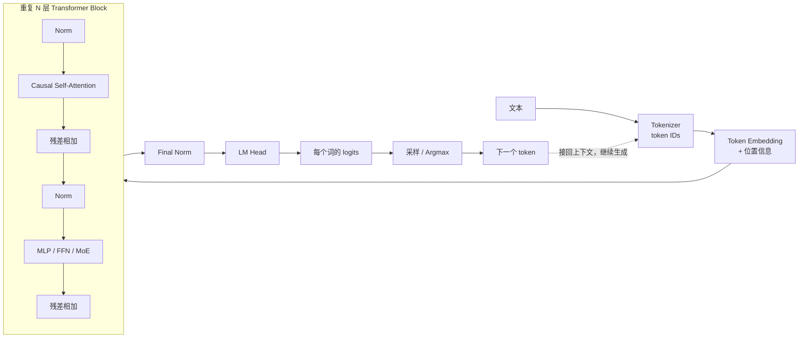

把 Transformer / Decoder‑only 的整体结构过一遍，各个组件分别在干什么，有哪些常见变体。


一句话抓住核心：**Decoder-only Transformer 就是把“到目前为止的所有 token”反复经过注意力和非线性变换，预测下一个 token，然后把新 token 接回输入继续预测。**



## 1. Transformer 家族的三种基本形态

| 结构 | 能看到什么 | 典型用途 | 代表 |
|---|---|---|---|
| Encoder-only | 同时看到左右两边 | 理解、分类、向量表示 | BERT |
| Encoder–Decoder | Encoder 读完整输入，Decoder 逐步生成 | 翻译、摘要、条件生成 | T5、原始 Transformer |
| Decoder-only | 只能看到当前 token 及之前的 token | 自回归生成、通用大模型 | GPT、Llama、Qwen |

一个容易混淆的点：

- 原始 Transformer 的 **Decoder 层**包含两种注意力：因果自注意力和对 Encoder 输出的交叉注意力。
- **Decoder-only 模型没有 Encoder，因此也没有标准的 cross-attention**，通常只有 causal self-attention。

---

## 2. 输入：Tokenizer

Tokenizer 把文本切成 token，再映射成整数 ID：

```text
"Transformers are useful"
          ↓
["Transform", "ers", " are", " useful"]
          ↓
[1324, 286, 527, 8912]
```

常见方案：

- BPE：GPT 系列常见。
- WordPiece：BERT 常见。
- SentencePiece：直接在 Unicode 文本上训练，Llama、T5 等常见。
- Byte-level tokenizer：几乎不会遇到真正的“未知字符”，但某些语言可能被切得更碎。

Tokenizer 不属于神经网络主体，但它会影响：

- 序列长度与推理成本；
- 多语言表现；
- 数字、代码和特殊字符处理；
- 模型看到的最小语义单位。

---

## 3. Token Embedding

每个 token ID 对应一个可学习向量：

\[
x_i = E[\text{token}_i]
\]

如果隐藏维度是 \(d_{\text{model}}\)，输入序列最终变成：

\[
X \in \mathbb{R}^{L \times d_{\text{model}}}
\]

其中：

- \(L\)：token 数量；
- \(d_{\text{model}}\)：每个 token 的表示维度。

Embedding 表的作用可以理解成：给每个 token 一个初始的“语义坐标”。

常见变体：

- 输入 Embedding 和输出 LM Head 权重共享，称为 **weight tying**；
- 输入和输出使用独立权重；
- 为特殊模态增加额外 Embedding，例如图像 token、音频 token。

---

## 4. 位置信息

纯注意力本身不知道顺序。对它来说，如果不加入位置信息，“猫追狗”和“狗追猫”只是同一组向量的不同排列。

常见方案：

### 绝对位置编码

直接给第 \(i\) 个 token 加一个位置向量：

\[
x_i = \text{TokenEmb}(t_i) + \text{PosEmb}(i)
\]

包括：

- 固定的正弦位置编码；
- Learned Position Embedding。

简单，但通常不容易自然外推到训练长度之外。

### RoPE

现在 Decoder-only 模型非常常见。它不是把位置向量加到输入上，而是根据位置旋转 Q、K：

\[
q_i' = R_i q_i,\qquad k_j' = R_j k_j
\]

这样 \(q_i'^T k_j'\) 会自然包含相对距离信息。

常见扩展：

- RoPE scaling；
- NTK-aware scaling；
- YaRN；
- LongRoPE；
- 部分维度使用 RoPE。

这些主要用于扩展上下文长度。

### ALiBi

直接给注意力分数加入与距离相关的偏置：

\[
S_{ij} = q_i^T k_j - m|i-j|
\]

距离越远，惩罚越大。结构简单，也有一定长度外推能力。

---

## 5. Transformer Block

一个现代 Decoder-only Block 通常是：

```text
x
├─ Norm → Causal Self-Attention → + ─┐
└────────────────────────────────────┘
                                      ↓
                                     x'
├─ Norm → MLP / MoE → + ─────────────┐
└─────────────────────────────────────┘
                                      ↓
                                   下一层
```

核心就是两件事：

1. Attention：让 token 之间交换信息；
2. MLP：让每个 token 在自己的通道维度内进行复杂计算。

残差连接把输入直接送到输出，使深层网络更容易训练。

---

## 6. Normalization

Norm 用来控制激活值的尺度，让几十甚至上百层网络保持稳定。

### LayerNorm

对一个 token 的隐藏维度做归一化：

\[
\text{LN}(x)=\gamma\frac{x-\mu}{\sqrt{\sigma^2+\epsilon}}+\beta
\]

### RMSNorm

不减均值，只根据均方根缩放：

\[
\text{RMSNorm}(x)
=
\gamma\frac{x}{\sqrt{\frac{1}{d}\sum_i x_i^2+\epsilon}}
\]

RMSNorm 更简单，在现代大模型中很常见。

### Pre-Norm 与 Post-Norm

原始 Transformer 使用 Post-Norm：

\[
x' = \text{Norm}(x+\text{Attention}(x))
\]

现代大模型更多使用 Pre-Norm：

\[
x' = x+\text{Attention}(\text{Norm}(x))
\]

Pre-Norm 通常更容易稳定训练深层模型。其他变体还有：

- Sandwich Norm；
- DeepNorm；
- QK-Norm；
- NormFormer；
- 无显式 Norm 的实验性结构。

---

## 7. Causal Self-Attention

这是 Decoder-only 最关键的组件。

首先从同一个输入 \(X\) 生成 Query、Key、Value：

\[
Q=XW_Q,\qquad K=XW_K,\qquad V=XW_V
\]

再计算：

\[
\text{Attention}(Q,K,V)
=
\text{softmax}
\left(
\frac{QK^T}{\sqrt{d_k}}+M
\right)V
\]

可以这样理解：

- Query：当前 token 在找什么；
- Key：每个历史 token 能提供什么索引；
- \(QK^T\)：当前 token 应该关注谁；
- Value：被关注 token 真正传递的内容；
- Softmax：把相关度变成权重；
- 加权求和：把需要的信息收集回来。

### Causal Mask

生成第 \(i\) 个位置时，不能偷看未来：

```text
          可被关注的 Key
          1  2  3  4
Query 1   ✓  ✗  ✗  ✗
      2   ✓  ✓  ✗  ✗
      3   ✓  ✓  ✓  ✗
      4   ✓  ✓  ✓  ✓
```

未来位置的注意力分数会被设成负无穷，经过 Softmax 后权重变成 0。

这就是 Decoder-only 能用于“预测下一个 token”的关键约束。

---

## 8. 多头注意力及其变体

### MHA：Multi-Head Attention

把隐藏维度分成多个头：

\[
\text{head}_h
=
\text{Attention}(XW_Q^h,XW_K^h,XW_V^h)
\]

不同头可以学习不同关系，例如：

- 指代关系；
- 局部语法；
- 长距离依赖；
- 代码括号匹配；
- 从上下文复制实体。

最后拼接所有头，再做一次输出投影。

### MQA：Multi-Query Attention

所有 Query 头共享一组 K、V：

```text
多个 Q head
    ↓
共享 K、V
```

优点是 KV Cache 非常小、生成速度快；缺点是表达能力可能有所损失。

### GQA：Grouped-Query Attention

多个 Query 头分组共享 K、V，是 MHA 和 MQA 的折中：

- 质量通常接近 MHA；
- KV Cache 明显小于 MHA；
- 现代 LLM 非常常见。

### MLA：Multi-head Latent Attention

先把 K、V 压缩到低维潜在表示，使用时再恢复或吸收进投影矩阵。目标同样是减少 KV Cache，但方案比 GQA 更激进。

### 长上下文注意力变体

标准全注意力的计算量大约是：

\[
O(L^2d)
\]

因此长序列会非常昂贵。常见替代方案包括：

- Sliding-window attention：只看附近窗口；
- Local + Global attention：大部分 token 看局部，少数 token 看全局；
- Block-sparse attention；
- Ring Attention：把长序列分散到多个设备；
- FlashAttention：不改变数学结果，通过 IO 优化减少显存访问；
- 线性注意力：修改注意力计算，将复杂度压低；
- Attention + SSM 混合结构。

注意：**FlashAttention 是精确注意力的高效实现，不是一种新的注意力语义。**

---

## 9. MLP / FFN

Attention 负责 token 之间通信，MLP 负责对每个 token 的表示进行非线性加工。

经典形式：

\[
\text{FFN}(x)
=
W_2\,\text{GELU}(W_1x)
\]

通常先把维度扩大，再投影回来：

```text
d_model → 约 4 × d_model → d_model
```

MLP 对每个位置独立执行，但所有位置共享同一套参数。

### 激活函数变体

- ReLU：原始、简单；
- GELU：GPT、BERT 中常见；
- SwiGLU：现代 LLM 常见；
- GeGLU；
- ReGLU。

SwiGLU 的简化形式是：

\[
\text{SwiGLU}(x)
=
\text{SiLU}(xW_g)\odot(xW_u)
\]

再通过一个下投影回到模型维度。这里的门控机制允许网络控制哪些特征通过。

### MoE：Mixture of Experts

把一个密集 MLP 换成多个 Expert：

```text
token → Router → 选择 Top-k Experts → 合并结果
```

例如模型总参数很多，但每个 token 只激活两个 Expert。

优势：

- 增加参数容量；
- 每 token 计算量不必同比增长。

难点：

- 负载均衡；
- Expert 并行与通信；
- 路由稳定性；
- 某些 Expert 过载或训练不足。

---

## 10. 残差连接

每个子层通常都有：

\[
x' = x + F(x)
\]

作用包括：

- 保留原始信息；
- 让梯度拥有更直接的传播路径；
- 让每一层只需要学习“应该修改什么”；
- 支撑非常深的网络。

一些模型会进一步采用：

- 可学习的残差缩放；
- LayerScale；
- DeepNorm；
- Parallel residual：Attention 和 MLP 并行计算后一起相加。

串行结构：

\[
x' = x+A(x),\qquad y=x'+M(x')
\]

并行结构：

\[
y=x+A(\text{Norm}(x))+M(\text{Norm}(x))
\]

并行结构可以减少部分串行依赖。

---

## 11. 输出层：LM Head

经过所有 Block 后：

```text
hidden state
→ Final Norm
→ 线性投影到词表大小
→ logits
```

假设词表有 \(V\) 个 token：

\[
z_t = h_tW_{\text{vocab}}
\in \mathbb{R}^{V}
\]

Softmax 把 logits 变成下一个 token 的概率：

\[
P(x_{t+1}=v\mid x_{\le t})
=
\text{softmax}(z_t)_v
\]

LM Head 经常与输入 Embedding 共享权重：

\[
W_{\text{vocab}}=E^T
\]

这样可以减少参数，也让输入和输出 token 使用同一个表示空间。

---

## 12. 模型是怎么训练的

训练目标通常是 next-token prediction：

```text
输入：   我  喜欢  吃  苹
目标：   喜欢  吃  苹  果
```

目标函数是交叉熵：

\[
\mathcal{L}
=
-\sum_t\log P(x_{t+1}\mid x_{\le t})
\]

训练时整段序列可以并行计算，因为正确答案已经存在，只需要通过 causal mask 防止偷看未来。这叫 **teacher forcing**。

因此：

- 训练：所有位置并行预测；
- 生成：必须一个 token 一个 token 地进行。

这也是为什么生成速度远慢于一次性处理同样长度的文本。

---

## 13. 推理：Prefill、Decode 与 KV Cache

### Prefill

先把用户的完整 Prompt 一次送进模型，计算所有 token 的 K、V。

特点：

- 可以并行；
- 计算密集；
- 长 Prompt 的主要开销在这里。

### Decode

每次只输入一个新 token，预测下一个 token。

如果每一步都重新计算所有历史 token，会大量浪费计算。因此保存历史层的 K、V：

```text
过去 token 的 K、V → KV Cache
新 token 只计算自己的 Q、K、V
Q 查询历史 KV Cache
```

特点：

- 每一步的数据量很小；
- 但需要读取大量 KV Cache；
- 通常更偏内存带宽瓶颈；
- MQA、GQA、MLA 的重要目标就是降低这里的成本。

---

## 14. 从 logits 到最终文本

模型本身只输出概率分布。如何选 token 属于 decoding strategy：

- Greedy：每次选择概率最高的 token；
- Temperature：调整分布的尖锐程度；
- Top-k：只在概率最高的 \(k\) 个 token 中采样；
- Top-p：在累计概率达到 \(p\) 的最小集合中采样；
- Repetition penalty：降低重复 token 的概率；
- Beam search：维护多条候选路径，传统翻译任务较常见。

温度大致作用于：

\[
P(v)=\text{softmax}(z_v/T)
\]

- \(T<1\)：更确定、更保守；
- \(T>1\)：更随机、更多样；
- \(T\to0\)：接近 greedy。

采样策略不是模型结构的一部分，但会明显改变输出风格。

---

## 15. 最常见的现代 Decoder-only 配方

一个典型现代 LLM 大致是：

```text
Tokenizer
→ Token Embedding
→ N × [
    RMSNorm
    → RoPE + GQA Causal Attention
    → Residual
    → RMSNorm
    → SwiGLU MLP 或 MoE
    → Residual
  ]
→ Final RMSNorm
→ Tied LM Head
→ Next-token logits
```

可以把它压缩成四句话：

1. **Embedding**：把 token 变成向量。
2. **Attention**：从上下文中读取相关信息。
3. **MLP/MoE**：对读取到的信息进行计算和变换。
4. **LM Head**：把最终状态翻译成下一个 token 的概率。

最重要的整体认知是：**模型每经过一层，都在更新每个 token 的“当前理解”；Attention 负责横向读上下文，MLP 负责纵向做计算，残差负责保存信息，Norm 负责维持数值稳定。**