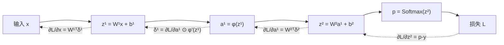

把 BP 反向传播的关键量推一遍，说清梯度如何在各层流动与计算。


BP（Backpropagation，反向传播）的本质是：

> **从标量损失出发，沿计算图反向应用链式法则，把下游梯度乘以每个算子的局部导数，得到各层参数和输入的梯度。**

它只负责计算梯度；SGD、Adam 等优化器负责使用梯度更新参数。



## 1. 先从标量链式法则开始

假设：

\[
x\xrightarrow{f}y\xrightarrow{g}z\xrightarrow{h}L
\]

即：

\[
y=f(x),\qquad z=g(y),\qquad L=h(z)
\]

那么：

\[
\frac{\partial L}{\partial x}
=
\frac{\partial L}{\partial z}
\frac{\partial z}{\partial y}
\frac{\partial y}{\partial x}
\]

反向传播就是从：

\[
\frac{\partial L}{\partial L}=1
\]

开始，逐步向前面的变量计算梯度。

每个节点只需要知道两件事：

1. 从下游传来的梯度；
2. 自己的局部导数。

计算规则是：

\[
\text{上游梯度}
=
\text{下游梯度}
\times
\text{局部导数}
\]

---

## 2. 单个神经元怎么反传

考虑一个神经元：

\[
z=w^Tx+b
\]

\[
a=\phi(z)
\]

\[
L=\ell(a,y)
\]

定义下游传给激活输出的梯度：

\[
g_a=\frac{\partial L}{\partial a}
\]

经过激活函数：

\[
\delta
\equiv
\frac{\partial L}{\partial z}
=
\frac{\partial L}{\partial a}
\frac{\partial a}{\partial z}
=
g_a\phi'(z)
\]

这里的 \(\delta\) 通常称为该层的误差信号。

因为：

\[
z=\sum_iw_ix_i+b
\]

所以：

\[
\frac{\partial z}{\partial w_i}=x_i
\]

\[
\frac{\partial z}{\partial x_i}=w_i
\]

\[
\frac{\partial z}{\partial b}=1
\]

得到：

\[
\frac{\partial L}{\partial w_i}
=
\delta x_i
\]

\[
\frac{\partial L}{\partial x_i}
=
\delta w_i
\]

\[
\frac{\partial L}{\partial b}
=
\delta
\]

因此一个神经元反向传播做三件事：

- 给权重计算梯度；
- 给偏置计算梯度；
- 给上一层输入计算梯度，继续往前传播。

---

## 3. 全连接层的关键公式

考虑第 \(l\) 层：

\[
z^{(l)}
=
W^{(l)}a^{(l-1)}+b^{(l)}
\]

\[
a^{(l)}
=
\phi^{(l)}(z^{(l)})
\]

形状设为：

\[
a^{(l-1)}\in\mathbb R^{n_{l-1}}
\]

\[
W^{(l)}
\in
\mathbb R^{n_l\times n_{l-1}}
\]

\[
z^{(l)},a^{(l)},b^{(l)}
\in
\mathbb R^{n_l}
\]

定义：

\[
\delta^{(l)}
\equiv
\frac{\partial L}{\partial z^{(l)}}
\]

那么这一层的三个核心梯度是：

\[
\boxed{
\frac{\partial L}{\partial W^{(l)}}
=
\delta^{(l)}
(a^{(l-1)})^T
}
\]

\[
\boxed{
\frac{\partial L}{\partial b^{(l)}}
=
\delta^{(l)}
}
\]

\[
\boxed{
\frac{\partial L}{\partial a^{(l-1)}}
=
(W^{(l)})^T\delta^{(l)}
}
\]

第三个公式把梯度传给上一层。

然后经过上一层激活函数：

\[
\boxed{
\delta^{(l-1)}
=
\left[
(W^{(l)})^T\delta^{(l)}
\right]
\odot
\phi'(z^{(l-1)})
}
\]

其中 \(\odot\) 表示逐元素相乘。

这就是多层神经网络反向传播最核心的递推公式。

---

## 4. 为什么反传时要乘 \(W^T\)

前向传播：

\[
z=Wa
\]

展开：

\[
z_i=\sum_jW_{ij}a_j
\]

上一层第 \(j\) 个神经元 \(a_j\) 会影响当前层所有 \(z_i\)，因此：

\[
\frac{\partial L}{\partial a_j}
=
\sum_i
\frac{\partial L}{\partial z_i}
\frac{\partial z_i}{\partial a_j}
\]

而：

\[
\frac{\partial z_i}{\partial a_j}=W_{ij}
\]

所以：

\[
\frac{\partial L}{\partial a_j}
=
\sum_i\delta_iW_{ij}
\]

写成矩阵形式就是：

\[
\frac{\partial L}{\partial a}
=
W^T\delta
\]

转置不是一个额外规定，而是矩阵乘法和链式法则自然产生的。

---

## 5. 两层 MLP 完整推导

考虑分类网络：

\[
z^{(1)}=W^{(1)}x+b^{(1)}
\]

\[
h=\operatorname{ReLU}(z^{(1)})
\]

\[
z^{(2)}=W^{(2)}h+b^{(2)}
\]

\[
p=\operatorname{softmax}(z^{(2)})
\]

\[
L=-\sum_cp_c^{\text{target}}\log p_c
\]

如果真实标签使用 one-hot 向量 \(y\)，则：

\[
L=-\sum_cy_c\log p_c
\]

### 第一步：输出层梯度

Softmax：

\[
p_i
=
\frac{e^{z_i}}
{\sum_je^{z_j}}
\]

它的导数是：

\[
\frac{\partial p_i}{\partial z_j}
=
p_i(\mathbf 1_{i=j}-p_j)
\]

与交叉熵合并后，大量项会抵消，最终得到非常简洁的结果：

\[
\boxed{
\delta^{(2)}
=
\frac{\partial L}{\partial z^{(2)}}
=
p-y
}
\]

这不是说 Softmax 的导数等于 \(p-y\)，而是：

> **Softmax 和交叉熵组合后的 logits 梯度等于 \(p-y\)。**

### 第二步：输出层参数梯度

因为：

\[
z^{(2)}=W^{(2)}h+b^{(2)}
\]

所以：

\[
\boxed{
\frac{\partial L}{\partial W^{(2)}}
=
\delta^{(2)}h^T
}
\]

\[
\boxed{
\frac{\partial L}{\partial b^{(2)}}
=
\delta^{(2)}
}
\]

### 第三步：梯度传给隐藏层

\[
\frac{\partial L}{\partial h}
=
(W^{(2)})^T\delta^{(2)}
\]

### 第四步：经过 ReLU

ReLU：

\[
h_i=\max(0,z_i^{(1)})
\]

局部导数：

\[
\operatorname{ReLU}'(z_i)
=
\begin{cases}
1,&z_i>0\\
0,&z_i<0
\end{cases}
\]

因此：

\[
\boxed{
\delta^{(1)}
=
\left[
(W^{(2)})^T\delta^{(2)}
\right]
\odot
\mathbf 1_{z^{(1)}>0}
}
\]

当某个 ReLU 的前向输入小于零时，它在反向传播中也会把对应梯度置零。

### 第五步：第一层参数梯度

\[
\boxed{
\frac{\partial L}{\partial W^{(1)}}
=
\delta^{(1)}x^T
}
\]

\[
\boxed{
\frac{\partial L}{\partial b^{(1)}}
=
\delta^{(1)}
}
\]

如果还需要输入梯度：

\[
\boxed{
\frac{\partial L}{\partial x}
=
(W^{(1)})^T\delta^{(1)}
}
\]

完整反向过程可以压缩为：

```text
δ² = p - y

dW² = δ²hᵀ
db² = δ²
dh  = W²ᵀδ²

δ¹  = dh ⊙ ReLU'(z¹)

dW¹ = δ¹xᵀ
db¹ = δ¹
dx  = W¹ᵀδ¹
```

---

## 6. 批量数据时怎么计算

假设一个 batch 有 \(B\) 个样本，并把每个样本放在矩阵的一列：

\[
A^{(l-1)}
\in
\mathbb R^{n_{l-1}\times B}
\]

\[
Z^{(l)}
=
W^{(l)}A^{(l-1)}
+
b^{(l)}\mathbf 1^T
\]

\[
\Delta^{(l)}
=
\frac{\partial L}{\partial Z^{(l)}}
\in
\mathbb R^{n_l\times B}
\]

如果损失取 batch 平均，则：

\[
\boxed{
\frac{\partial L}{\partial W^{(l)}}
=
\frac1B
\Delta^{(l)}
(A^{(l-1)})^T
}
\]

\[
\boxed{
\frac{\partial L}{\partial b^{(l)}}
=
\frac1B
\Delta^{(l)}\mathbf 1
}
\]

\[
\boxed{
\frac{\partial L}{\partial A^{(l-1)}}
=
(W^{(l)})^T\Delta^{(l)}
}
\]

权重梯度本质上是：

> **当前层误差信号与上一层激活之间的外积，再对 batch 中所有样本求和或平均。**

有些框架把 \(1/B\) 放在损失函数中，因此反向公式里不再显式出现。关键是只能平均一次。

---

## 7. 不同激活函数怎样影响梯度

### Sigmoid

\[
\sigma(z)=\frac1{1+e^{-z}}
\]

\[
\sigma'(z)=\sigma(z)(1-\sigma(z))
\]

最大导数只有 \(0.25\)。当 \(|z|\) 很大时，导数接近 0，容易造成梯度消失。

如果 Sigmoid 与二元交叉熵组合，logit 梯度同样可简化为：

\[
\frac{\partial L}{\partial z}=p-y
\]

### Tanh

\[
\tanh'(z)=1-\tanh^2(z)
\]

输出以 0 为中心，但饱和区导数仍接近 0。

### ReLU

\[
\operatorname{ReLU}'(z)=
\begin{cases}
1,&z>0\\
0,&z<0
\end{cases}
\]

正半轴不会缩小梯度，但长期落在负半轴的神经元可能成为“死亡 ReLU”。

### GELU、SiLU

导数更加平滑，在 Transformer 等现代网络中常见。它们允许负值区域保留一部分非零梯度，但仍会改变梯度的尺度。

---

## 8. 分支、汇合和参数复用

反向传播有两条非常重要的规则。

### 串行路径：梯度相乘

\[
x\to f\to g\to L
\]

则：

\[
\frac{\partial L}{\partial x}
=
\frac{\partial L}{\partial g}
\frac{\partial g}{\partial f}
\frac{\partial f}{\partial x}
\]

### 多条路径：梯度相加

如果变量 \(x\) 同时影响两个分支：

\[
L=L_1(x)+L_2(x)
\]

则：

\[
\frac{\partial L}{\partial x}
=
\frac{\partial L_1}{\partial x}
+
\frac{\partial L_2}{\partial x}
\]

这也是自动微分框架为什么要对梯度做累加。

### 参数共享

如果同一个参数 \(W\) 在多个位置被使用：

\[
L=L(W,W,\dots)
\]

那么：

\[
\frac{\partial L}{\partial W}
=
\sum_{\text{所有使用位置}}
\frac{\partial L}{\partial W}\bigg|_{\text{该位置}}
\]

例如：

- CNN 的同一个卷积核作用于所有空间位置；
- RNN 的同一个权重作用于所有时间步；
- Transformer 的同一层权重作用于所有 token；
- Embedding 中同一个 token 出现多次。

最终梯度都是各个使用位置贡献的总和。

---

## 9. 残差连接中的梯度

残差结构：

\[
y=x+F(x)
\]

设下游梯度为：

\[
g=\frac{\partial L}{\partial y}
\]

由于 \(x\) 通过两条路径影响 \(y\)：

1. 恒等路径 \(x\to y\)；
2. 非线性路径 \(x\to F(x)\to y\)。

因此：

\[
\boxed{
\frac{\partial L}{\partial x}
=
g+
J_F(x)^Tg
}
\]

其中 \(J_F\) 是 \(F\) 的 Jacobian。

关键是第一项：

\[
g
\]

它让梯度可以不经过复杂变换，直接沿恒等路径传播。这就是 ResNet 和 Transformer 残差连接能帮助训练深层网络的重要原因。

---

## 10. 卷积层如何反传

卷积层仍然遵循同样的链式法则。

前向可写为：

\[
Y=X*W+b
\]

反向需要计算：

\[
\frac{\partial L}{\partial W}
\]

\[
\frac{\partial L}{\partial X}
\]

\[
\frac{\partial L}{\partial b}
\]

直观上：

- 权重梯度：输入局部窗口与输出误差信号做相关，并对 batch 和空间位置累加；
- 输入梯度：输出误差信号使用翻转、转置后的卷积核传播回输入位置；
- 偏置梯度：输出误差信号在 batch、高和宽上求和。

因为同一个卷积核在所有位置共享，所以所有空间位置都会为同一个卷积核贡献梯度：

\[
\frac{\partial L}{\partial W}
=
\sum_{\text{batch, position}}
\text{输入局部窗口}
\times
\text{对应输出梯度}
\]

因此卷积反传不是另一套原理，只是权重共享和空间索引让矩阵表达更加复杂。

---

## 11. Dropout 怎么反传

训练时：

\[
a'=\frac{m\odot a}{1-p}
\]

其中 \(m\) 是 0/1 mask。

反向时必须使用前向阶段相同的 mask：

\[
\frac{\partial L}{\partial a}
=
\frac{m}{1-p}
\odot
\frac{\partial L}{\partial a'}
\]

前向被 Dropout 置零的位置，反向梯度同样为零。

推理时不使用 Dropout，因此也不存在对应的随机 mask。

---

## 12. 自动微分实际做了什么

PyTorch 等框架使用反向模式自动微分。

### 前向阶段

框架会：

1. 执行计算；
2. 构建计算图；
3. 保存反向需要的中间量。

例如 ReLU 反向需要知道哪些位置的输入大于 0，矩阵乘法反向需要输入和权重。

### 反向阶段

从标量损失开始：

\[
\frac{\partial L}{\partial L}=1
\]

然后按照计算图的逆拓扑顺序执行每个算子的 backward：

```text
Loss
→ Softmax/CrossEntropy backward
→ Linear backward
→ Activation backward
→ Linear backward
→ ...
```

每个 backward 接收下游梯度，返回对输入和参数的梯度。

简化的训练过程：

```python
optimizer.zero_grad()

prediction = model(x)
loss = criterion(prediction, y)

loss.backward()
optimizer.step()
```

含义是：

- `zero_grad()`：清空上一步累积的参数梯度；
- 前向传播：计算预测和损失；
- `backward()`：执行反向传播，填充参数的 `.grad`；
- `step()`：优化器更新参数。

PyTorch 默认会累加梯度，所以如果不清零：

\[
g_{\text{total}}
=
g_{\text{previous}}
+
g_{\text{current}}
\]

梯度累积训练正是利用这一行为。

---

## 13. 参数怎么更新

最简单的 SGD：

\[
W\leftarrow W-\eta\frac{\partial L}{\partial W}
\]

\[
b\leftarrow b-\eta\frac{\partial L}{\partial b}
\]

其中 \(\eta\) 是学习率。

负梯度方向是损失局部下降最快的方向。

Adam、Momentum、AdamW 不会改变 BP 计算出来的梯度，只是以不同方式处理梯度后更新参数：

```text
BP：计算梯度
优化器：决定如何使用梯度
```

---

## 14. 为什么会梯度消失或爆炸

隐藏层递推：

\[
\delta^{(l)}
=
(W^{(l+1)})^T
\delta^{(l+1)}
\odot
\phi'(z^{(l)})
\]

展开后，前面层的梯度包含很多 Jacobian 的乘积：

\[
\frac{\partial L}{\partial a^{(l)}}
=
J_{l+1}^TJ_{l+2}^T\dots J_L^T
\frac{\partial L}{\partial a^{(L)}}
\]

如果这些矩阵的尺度大多小于 1，连续相乘后梯度趋近 0：

\[
0.5^{100}\approx0
\]

这就是梯度消失。

如果尺度大多大于 1，连续相乘后梯度可能急剧增大，这就是梯度爆炸。

常见缓解方法：

- Xavier、He 初始化；
- ReLU、GELU、SiLU；
- 残差连接；
- LayerNorm、BatchNorm、RMSNorm；
- 合理学习率；
- 梯度裁剪；
- Pre-Norm；
- 门控结构；
- 缩短反向路径。

梯度裁剪通常是：

\[
g
\leftarrow
g\cdot
\min
\left(
1,\frac{\tau}{\lVert g\rVert}
\right)
\]

它限制梯度范数，但不解决梯度爆炸的根本原因。

---

## 15. 用向量—Jacobian 乘积理解 BP

对向量函数：

\[
y=f(x)
\]

Jacobian 是：

\[
J_f=
\frac{\partial y}{\partial x}
\]

如果下游梯度是：

\[
g_y=\frac{\partial L}{\partial y}
\]

则：

\[
g_x
=
J_f^Tg_y
\]

实际框架通常不会显式构造完整 Jacobian，因为它可能非常大，而是直接计算：

\[
J_f^Tg_y
\]

这叫 Vector–Jacobian Product，VJP。

反向传播高效的关键就在这里：

> 对一个标量损失求大量参数的梯度，只需要一次反向遍历，不需要为每个参数单独计算导数。

---

## 16. 最后记住这组公式

对任意全连接层：

\[
z^{(l)}
=
W^{(l)}a^{(l-1)}+b^{(l)}
\]

\[
a^{(l)}
=
\phi(z^{(l)})
\]

反向传播：

\[
\boxed{
\delta^{(l)}
=
\frac{\partial L}{\partial z^{(l)}}
}
\]

\[
\boxed{
\frac{\partial L}{\partial W^{(l)}}
=
\delta^{(l)}(a^{(l-1)})^T
}
\]

\[
\boxed{
\frac{\partial L}{\partial b^{(l)}}
=
\delta^{(l)}
}
\]

\[
\boxed{
\frac{\partial L}{\partial a^{(l-1)}}
=
(W^{(l)})^T\delta^{(l)}
}
\]

\[
\boxed{
\delta^{(l-1)}
=
\left[
(W^{(l)})^T\delta^{(l)}
\right]
\odot
\phi'(z^{(l-1)})
}
\]

对于 Softmax 加交叉熵：

\[
\boxed{
\delta^{(L)}=p-y
}
\]

可以把整个 BP 浓缩成一句话：

> **误差信号先通过激活函数的局部导数做逐元素过滤，再通过权重转置传播到上一层；与此同时，它与上一层激活做外积，形成当前层权重的梯度。**