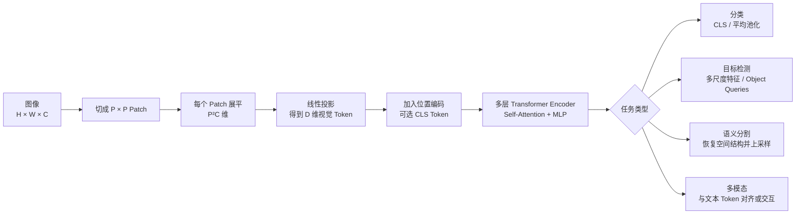

你怎么把 Transformer 用到图像任务上的？和 CNN 相比优劣在哪些场景体现？


核心做法是：**把图像切成 patch，把每个 patch 当成一个 token，再交给 Transformer 编码。**这就是 Vision Transformer（ViT）的基本思想。



## 一、图像怎么变成 Transformer 的输入

假设输入图像是：

\[
X\in\mathbb R^{H\times W\times C}
\]

切成大小为 \(P\times P\) 的不重叠 patch，patch 数量是：

\[
N=\frac{H}{P}\times\frac{W}{P}
\]

每个 patch 包含 \(P^2C\) 个数，将其展平并线性投影到 \(D\) 维：

\[
z_i=x_iW_E+b
\]

于是得到一个 token 序列：

\[
Z\in\mathbb R^{N\times D}
\]

例如一张 \(224\times224\) 的 RGB 图像，patch 大小为 \(16\times16\)：

\[
N=\frac{224}{16}\times\frac{224}{16}=14\times14=196
\]

所以图像会变成 196 个视觉 token。

工程上，Patch Embedding 通常直接用卷积实现：

```text
Conv2d(
    kernel_size=16,
    stride=16
)
```

这在数学上近似等价于对每个不重叠 patch 使用同一个线性投影。

---

## 二、位置编码为什么重要

Transformer 自身不知道 patch 在图像中的二维位置。如果不加位置信息：

```text
左上角 patch
右下角 patch
```

对模型来说只是序列中的两个向量，无法天然知道它们的空间关系。

因此需要加入：

- 可学习绝对位置编码；
- 二维正弦位置编码；
- 相对位置偏置；
- RoPE 的二维扩展；
- Swin Transformer 中的窗口相对位置编码。

基本 ViT 使用：

\[
Z_0=
[x_{\text{cls}};x_1W_E;\dots;x_NW_E]+E_{\text{pos}}
\]

其中 `CLS Token` 是额外加入的可学习向量，用来汇总整张图像的信息。

分类时可以使用：

- CLS Token 的输出；
- 所有视觉 token 的平均；
- Attention Pooling。

---

## 三、Transformer 如何处理视觉 Token

每层通常包括：

```text
视觉 Token
→ LayerNorm
→ Multi-Head Self-Attention
→ 残差
→ LayerNorm
→ MLP
→ 残差
```

Self-Attention 计算：

\[
\operatorname{Attention}(Q,K,V)
=
\operatorname{softmax}
\left(
\frac{QK^T}{\sqrt{d}}
\right)V
\]

与文本 Decoder 不同，普通 ViT 通常使用的是 **双向 Encoder Self-Attention**：

- 每个 patch 可以看到所有其他 patch；
- 不需要 causal mask；
- 因为分类任务不是逐 patch 生成。

这样左上角的 patch 可以直接关注右下角的 patch，建立全局关系。

---

# 四、不同图像任务怎么接输出头

## 1. 图像分类

最简单：

```text
图像
→ ViT Encoder
→ CLS Token 或平均池化
→ 全连接分类头
→ 类别概率
```

训练目标通常是交叉熵。

如果数据量不大，一般不会从头训练，而是使用：

```text
预训练 ViT
→ 替换分类头
→ 微调
```

常见预训练方式包括监督预训练、MAE、DINO，以及图文对比学习。

## 2. 目标检测

检测任务需要输出：

- 目标类别；
- 边界框位置；
- 可能还有置信度和实例掩码。

常见方式有两类。

### Transformer 作为 Backbone

使用 Swin Transformer、PVT 等提取多尺度特征，再交给：

- Faster R-CNN；
- RetinaNet；
- FPN；
- Mask R-CNN；
- UPerNet。

这类似于把原来的 ResNet Backbone 换成 Transformer Backbone。

### DETR 风格

使用一组可学习的 Object Query：

```text
图像特征
      ↓
Transformer
      ↑
Object Queries
      ↓
每个 Query 预测一个目标
```

DETR 将检测建模为集合预测，可以减少 Anchor、NMS 等人工设计。

不过原始 DETR 仍然使用 CNN 提取图像特征；后续模型才逐渐采用纯 Transformer 或混合 Backbone。

## 3. 语义分割

需要为每个像素预测类别，因此不能只保留 CLS Token。

一般做法是：

1. 保留所有 patch token；
2. 将 token 恢复成二维特征图；
3. 使用 Decoder 或上采样；
4. 输出像素级类别。

```text
N × D Token
→ H/P × W/P × D 特征图
→ 多尺度融合
→ 上采样
→ H × W 分割结果
```

常见结构包括：

- ViT + UPerNet；
- Segmenter；
- SETR；
- Swin + 分割头；
- Mask2Former。

## 4. 图像生成

图像可以被离散化成视觉 token，然后使用类似语言模型的 Decoder-only Transformer 自回归生成：

\[
P(x)=\prod_tP(x_t\mid x_{<t})
\]

也可以在扩散模型中让 Transformer 预测噪声或速度，例如 DiT 类结构。

此时图像 patch 或 latent patch 相当于“视觉词元”。

## 5. 图文多模态

视觉 Transformer 将图像编码成视觉 token，文本 Transformer 将文本编码成文本 token，然后：

- 对比学习对齐图文向量，例如 CLIP；
- 用投影层把视觉 token 接入语言模型；
- 使用 Cross-Attention 融合图像和文本；
- 将视觉 token 与文本 token 一起送入多模态模型。

ViT 在多模态中非常自然，因为图像和文本最后都可以表达成 token 序列。

---

# 五、CNN 与 ViT 的根本差异

## CNN 的归纳偏置

卷积天然假设：

1. **局部性**：相邻像素更相关；
2. **平移等变性**：同一个物体移动位置后，卷积仍能识别；
3. **权重共享**：同一个卷积核扫描整张图；
4. **层次结构**：浅层学边缘，中层学纹理，深层学物体。

这些先验非常适合自然图像，因此 CNN 即使数据量不大，也能高效学习。

## ViT 的归纳偏置更弱

标准 ViT 不强制要求：

- 只关注局部邻域；
- 相邻 patch 一定更重要；
- 特征必须逐层扩大感受野。

它允许模型从数据中自己学习空间关系。

代价是：

- 小数据上更难训练；
- 更依赖预训练和数据增强；
- 需要更多数据才能学到 CNN 天然拥有的视觉先验。

但数据和模型规模足够大时，更弱的先验也意味着更少的表达限制。

---

# 六、CNN 与 Transformer 对比

| 维度 | CNN | Vision Transformer |
|---|---|---|
| 局部建模 | 天然擅长 | 标准 ViT 需要学习 |
| 全局关系 | 需要堆叠多层逐渐扩大感受野 | 一层全局 Attention 即可连接任意 patch |
| 平移等变性 | 天然较强 | 依赖数据和位置编码 |
| 小数据训练 | 通常更好 | 从头训练容易过拟合 |
| 大规模预训练 | 扩展性不错 | 通常更容易随数据和模型规模受益 |
| 高分辨率计算 | 卷积增长相对平稳 | 全局 Attention 成本很高 |
| 多尺度特征 | 天然形成层次结构 | 原始 ViT 不天然具有，需专门设计 |
| 多模态适配 | 需要额外融合结构 | Token 接口非常自然 |
| 推理部署 | 移动端生态成熟 | 某些模型算子和内存访问成本更高 |
| 可变分辨率 | 通常比较自然 | 可能需要位置编码插值 |
| 预训练迁移 | 成熟 | 大规模预训练后通常非常强 |
| 可解释性 | 可看特征图和卷积响应 | 可分析注意力，但不能把注意力直接等同于解释 |

---

# 七、ViT 的优势在哪些场景明显

## 1. 大规模数据和预训练

标准 ViT 从头训练需要较多数据，但经过大规模预训练后，迁移能力通常很强。

适合：

- 大规模图像分类；
- 基础视觉模型；
- 跨任务迁移；
- 自监督预训练；
- 图文预训练。

可以概括为：

```text
数据少、从头训练：CNN 往往更占优
预训练充分、规模变大：ViT 往往更有潜力
```

不过这不是绝对结论，训练配方、模型大小和数据质量同样重要。

## 2. 需要长距离关系

例如：

- 医学影像中相隔很远的组织关系；
- 遥感图像中的大范围地理结构；
- 文档图像中的跨区域布局；
- 细粒度识别中多个部位之间的组合关系；
- 场景理解中的物体关系。

全局 Attention 可以让相距很远的区域直接交互，而 CNN 通常要经过多层才能建立同等范围的联系。

## 3. 多模态任务

文本本身已经使用 Transformer。图像也转换成 token 后，二者很容易统一：

```text
视觉 Token + 文本 Token
→ Self-Attention / Cross-Attention
→ 多模态理解与生成
```

因此视觉问答、图像描述、图文检索和多模态大模型通常非常适合 Transformer。

## 4. 大模型扩展

ViT 的结构相对规则：

- 增加层数；
- 增加隐藏维度；
- 增加 Attention head；
- 增加预训练数据；
- 与文本模型共享类似的训练基础设施。

这让它很适合构建大规模通用视觉模型。

---

# 八、CNN 的优势在哪些场景明显

## 1. 数据量小且没有强预训练模型

CNN 的局部性和平移先验可以减少学习难度。

例如：

- 几千张工业缺陷图片；
- 小型医学数据集；
- 特定设备采集的小样本图像；
- 无法使用外部预训练权重的任务。

这种情况下，从头训练 CNN 往往更稳。ViT 也可以使用，但通常需要更强的数据增强、正则化或自监督预训练。

## 2. 移动端和边缘设备

CNN 在以下方面更成熟：

- 移动端卷积算子；
- 深度可分离卷积；
- INT8 量化；
- NPU/DSP 加速；
- 较低内存占用；
- 实时推理。

典型选择包括 MobileNet、EfficientNet、ShuffleNet。

Transformer 虽然 FLOPs 可能看起来不高，但 Attention、LayerNorm、张量变形和内存访问未必能在所有硬件上高效执行。

## 3. 高分辨率密集任务

如果图像尺寸增大，patch 数量 \(N\) 增加，而全局 Attention 的主要复杂度为：

\[
O(N^2D)
\]

由于：

\[
N=\frac{HW}{P^2}
\]

如果高和宽都扩大两倍：

- token 数变为 4 倍；
- 全局 Attention 矩阵变为约 16 倍。

CNN 的局部卷积复杂度通常更接近像素数量的线性增长，因此对超高分辨率图像更友好。

这也是为什么检测和分割中很少直接对所有高分辨率 token 使用朴素全局 Attention。

---

# 九、视觉 Transformer 的常见改进

## DeiT

目标是提高数据效率，使用：

- 强数据增强；
- 正则化；
- 知识蒸馏；
- 更合理的训练配方。

它说明 ViT 的数据效率问题不只来自架构，也与训练方法有关。

## Swin Transformer

把 Attention 限制在局部窗口中，并通过移动窗口让不同窗口交换信息：

```text
普通窗口 Attention
→ Shifted Window Attention
→ 普通窗口 Attention
```

同时逐阶段降低空间分辨率、增加通道数，形成类似 CNN 的层次结构。

优势：

- 计算量更接近随图像大小线性增长；
- 自然输出多尺度特征；
- 适合检测和分割。

## PVT 等层次化 Transformer

逐渐减少 token 数量、增加通道维度：

```text
高分辨率、低通道
→ 中分辨率、中通道
→ 低分辨率、高通道
```

这借鉴了 CNN 的特征金字塔设计。

## CNN–Transformer 混合结构

常见组合：

```text
卷积 Stem
→ 局部特征
→ Transformer 建模全局关系
```

或者在 Transformer Block 中加入深度卷积。

混合架构希望同时获得：

- CNN 的局部先验和高效性；
- Transformer 的全局建模和扩展能力。

---

# 十、实际怎么选

## 优先考虑 CNN

如果：

- 数据集较小；
- 必须从头训练；
- 主要依赖局部纹理；
- 需要移动端或低延迟部署；
- 高分辨率输入但算力有限；
- 希望使用成熟、稳定、容易优化的方案。

## 优先考虑标准 ViT

如果：

- 有大规模预训练权重；
- 数据规模很大；
- 任务依赖全局关系；
- 要构建图文多模态模型；
- 希望模型随数据与算力规模扩展；
- 训练和部署资源比较充足。

## 优先考虑 Swin 或层次化 Transformer

如果：

- 做目标检测或语义分割；
- 输入分辨率高；
- 需要多尺度特征；
- 不能承担全局 Attention 的平方复杂度。

## 优先考虑混合架构

如果：

- 既需要局部纹理，又需要全局关系；
- 数据规模中等；
- 希望在精度和效率之间折中；
- 部署硬件对卷积的支持明显更好。

最稳妥的实践不是抽象地判断“CNN 和 Transformer 谁更先进”，而是用相同的数据划分比较：

- 预训练条件；
- 参数量和计算量；
- 输入分辨率；
- 训练时间；
- 峰值显存；
- 推理延迟和吞吐量；
- 目标设备上的真实性能；
- 下游指标与鲁棒性。

最终可以这样记：

> **CNN 把局部性和平移结构写进模型里，因此小数据、局部视觉和高效部署更占优势；ViT 让模型从数据中学习更自由的全局关系，因此大规模预训练、跨任务迁移和多模态扩展更占优势。**