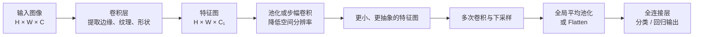

说下卷积层、池化层、全连接层各自作用与差异，实际项目你怎么选型？


一句话区分：

- **卷积层负责提取局部特征**；
- **池化层负责压缩空间尺寸、扩大有效感受野**；
- **全连接层负责综合特征并输出最终决策**。



## 一、卷积层：提取局部模式

卷积层使用一个小型卷积核在输入上滑动：

\[
y_{i,j,c_{\text{out}}}
=
\sum_{u,v,c_{\text{in}}}
W_{u,v,c_{\text{in}},c_{\text{out}}}
x_{i+u,j+v,c_{\text{in}}}
+b
\]

例如一个 \(3\times3\) 卷积核，每次查看周围 \(3\times3\) 的局部区域。

### 主要作用

浅层卷积通常学习：

- 边缘；
- 方向；
- 颜色变化；
- 简单纹理。

深层卷积在前面特征的基础上组合出：

- 物体局部；
- 形状；
- 语义结构；
- 完整目标。

可以理解为：

```text
像素
→ 边缘
→ 纹理
→ 局部形状
→ 物体
```

### 两个关键特性

#### 局部连接

输出位置只连接输入的一个局部区域，而不是连接整张图像。

这符合图像的空间规律：相邻像素通常比相距很远的像素关系更强。

#### 权重共享

同一个卷积核扫描整张图像：

```text
左上角检测竖边：使用卷积核 W
右下角检测竖边：仍然使用卷积核 W
```

因此，同一种特征无论出现在什么位置，都可以被检测出来，而且参数量远少于全连接层。

### 参数量

如果输入通道为 \(C_{\text{in}}\)，输出通道为 \(C_{\text{out}}\)，卷积核为 \(K_h\times K_w\)，参数量约为：

\[
K_hK_wC_{\text{in}}C_{\text{out}}
\]

与图像的高和宽没有直接关系。

例如：

```text
3×3 卷积
输入通道 64
输出通道 128
```

参数量为：

\[
3\times3\times64\times128=73728
\]

### 输出尺寸

单个空间维度的输出大小为：

\[
H_{\text{out}}
=
\left\lfloor
\frac{H+2P-D(K-1)-1}{S}+1
\right\rfloor
\]

其中：

- \(K\)：卷积核大小；
- \(S\)：Stride；
- \(P\)：Padding；
- \(D\)：Dilation。

常见配置：

```text
kernel=3, stride=1, padding=1
```

可以保持高宽不变。

### 常见卷积变体

- `1×1` 卷积：混合通道、改变通道数；
- `3×3` 卷积：最常见的局部特征提取；
- Strided Convolution：同时提取特征和下采样；
- Dilated Convolution：扩大感受野但不降低分辨率；
- Depthwise Separable Convolution：降低移动端计算量；
- Transposed Convolution：学习式上采样；
- 1D 卷积：时间序列、文本、音频波形；
- 3D 卷积：视频、CT、MRI 等体数据。

---

## 二、池化层：压缩空间信息

池化层在局部窗口内进行统计操作，通常不学习参数。

例如 \(2\times2\)、stride 为 2 的池化：

```text
输入：32 × 32 × 64
输出：16 × 16 × 64
```

它通常降低高和宽，不改变通道数。

## 1. Max Pooling

取窗口内最大值：

\[
y_{i,j,c}
=
\max_{(u,v)\in R_{i,j}}x_{u,v,c}
\]

例如：

```text
1  3
2  5
```

Max Pooling 输出 5。

它强调“某个特征是否在局部区域出现过”，适合保留强响应。

优点：

- 突出显著特征；
- 对小范围位置变化有一定鲁棒性；
- 计算简单；
- 没有可学习参数。

缺点：

- 只保留最大值，信息损失明显；
- 对最大值附近的噪声可能敏感；
- 不适合需要精确空间位置的任务。

## 2. Average Pooling

取窗口平均值：

\[
y_{i,j,c}
=
\frac{1}{|R|}
\sum_{(u,v)\in R}x_{u,v,c}
\]

它保留局部整体统计，不只关注最强响应。

优点：

- 输出更平滑；
- 对单个异常激活不那么敏感；
- 适合特征分布比“是否出现”更重要的场景。

缺点：

- 容易模糊边缘；
- 可能削弱少量但重要的强响应。

## 3. Global Average Pooling

对每个通道的整个空间区域取平均：

\[
y_c
=
\frac{1}{HW}
\sum_{i,j}x_{i,j,c}
\]

输入：

\[
H\times W\times C
\]

输出：

\[
1\times1\times C
\]

它常用于现代分类网络的末尾：

```text
特征图
→ Global Average Pooling
→ C 维向量
→ 小型全连接分类器
```

相较于 `Flatten + 大型全连接层`，它参数更少，也更不容易过拟合。

## 4. Adaptive Pooling

不指定固定窗口，而是指定输出大小：

```text
任意 H × W
→ AdaptiveAvgPool
→ 1 × 1
```

适合：

- 输入图像尺寸可变；
- 希望输出固定维度；
- 分类网络最后的汇聚层。

---

## 三、全连接层：综合特征并做决策

全连接层的每个输出都连接所有输入：

\[
y=Wx+b
\]

如果输入是 \(d_{\text{in}}\) 维，输出是 \(d_{\text{out}}\) 维，参数量为：

\[
d_{\text{in}}d_{\text{out}}+d_{\text{out}}
\]

例如：

```text
输入：7 × 7 × 512 = 25088
输出：4096
```

仅一个全连接层就有：

\[
25088\times4096
\approx1.03亿
\]

个权重。

这也是传统 CNN 中全连接层经常占据大量参数的原因。

### 主要作用

全连接层通常位于网络末尾，用于：

- 分类；
- 回归；
- 将视觉特征映射到目标维度；
- 融合已经压缩好的全局特征。

例如分类：

```text
2048 维视觉特征
→ Linear(2048, 1000)
→ 1000 个类别 logits
```

### 优点

- 能综合所有输入维度；
- 输出形式灵活；
- 适合最终任务头；
- 适合没有明确空间结构的向量。

### 缺点

- 参数量可能非常大；
- 容易过拟合；
- Flatten 后丢失显式空间结构；
- 输入尺寸通常必须固定；
- 不适合直接处理大型二维特征图。

现代 CNN 通常避免在高分辨率特征图后直接接大型全连接层，而是采用：

```text
Global Average Pooling
→ 一个小型 Linear
```

---

## 四、三者的核心差异

| 维度 | 卷积层 | 池化层 | 全连接层 |
|---|---|---|---|
| 主要作用 | 提取局部特征 | 下采样和汇聚 | 全局综合与输出 |
| 是否学习参数 | 是 | 通常否 | 是 |
| 是否保留空间结构 | 是 | 部分保留，但分辨率降低 | 通常不保留 |
| 连接方式 | 局部连接、权重共享 | 局部统计 | 所有输入与输出相连 |
| 参数量 | 相对可控 | 通常为 0 | 可能很大 |
| 输入尺寸灵活性 | 较好 | 较好 | Flatten 后较差 |
| 平移适应性 | 较强 | 进一步增强局部不变性 | 较弱 |
| 常见位置 | 网络主体 | 阶段之间 | 网络末尾 |
| 主要风险 | 计算量大、感受野有限 | 丢失空间信息 | 参数多、容易过拟合 |

---

# 五、池化还是步幅卷积

两者都可以下采样。

## 池化

```text
Conv(stride=1)
→ MaxPool(stride=2)
```

优点：

- 简单；
- 没有额外参数；
- 有一定平移鲁棒性；
- 小数据上可能具有正则化效果。

缺点：

- 下采样规则不可学习；
- 容易丢失细节。

## 步幅卷积

```text
Conv(stride=2)
```

优点：

- 下采样方式可以学习；
- 同时调整通道数；
- 模块更统一；
- 现代 ResNet、检测网络中非常常见。

缺点：

- 增加参数和计算；
- 训练不充分时不一定比池化好；
- 下采样仍会造成混叠和信息损失。

实际项目中，我通常这样选：

- 简单分类基线、小数据：MaxPool 可以保留；
- 现代分类 Backbone：多使用 stride=2 卷积；
- 检测和分割：使用可控的步幅卷积，并保留多尺度特征；
- 对混叠敏感：考虑 Blur Pooling 或先低通再下采样。

---

# 六、不同任务怎么选

## 1. 图像分类

典型结构：

```text
输入
→ 多组卷积
→ 分阶段下采样
→ Global Average Pooling
→ 小型全连接层
→ 类别 logits
```

我的默认选择：

- 主体使用卷积层提取特征；
- 每个阶段使用 stride=2 卷积或池化下采样；
- 最后使用全局平均池化；
- 只保留一个小型全连接分类头。

不建议：

```text
大尺寸特征图
→ Flatten
→ 多层超大全连接网络
```

因为参数多、输入尺寸固定，而且容易过拟合。

## 2. 目标检测

检测既要知道“是什么”，也要知道“在哪里”，因此不能过早丢失空间信息。

通常：

- 卷积 Backbone 提取多尺度特征；
- 分阶段下采样；
- 使用 FPN 融合高分辨率与低分辨率特征；
- 分类头和边界框回归头使用小型卷积或全连接层。

选择重点：

- 小目标多：保留较高分辨率特征；
- 大目标多：需要更大的感受野和深层特征；
- 避免早期过强池化；
- 使用多尺度输出，而不是只保留最后一层。

## 3. 语义分割

分割需要像素级输出，所以空间信息非常重要。

典型结构：

```text
Encoder：卷积 + 逐步下采样
Decoder：上采样 + 卷积
Skip Connection：恢复浅层细节
```

例如 U-Net：

- 下采样路径获取语义；
- 上采样路径恢复分辨率；
- 跳跃连接保留边缘和位置。

选择重点：

- 减少过度池化；
- 使用空洞卷积扩大感受野；
- 使用跳跃连接；
- 使用上采样、插值或转置卷积；
- 通常不在中间 Flatten，也不使用大型全连接层。

## 4. 小目标、关键点和细粒度定位

这些任务对位置变化非常敏感。

通常：

- 避免早期 Max Pooling；
- 保留高分辨率分支；
- 使用较小 stride；
- 使用空洞卷积扩大感受野；
- 必要时使用 HRNet、FPN 等多尺度结构。

因为池化虽然增强一定位置鲁棒性，却可能直接删除小目标或关键点。

## 5. 移动端和实时任务

重点是计算量、内存和目标硬件支持。

通常选择：

- Depthwise Separable Convolution；
- `1×1` 卷积做通道混合；
- 合理的 stride=2 下采样；
- Global Average Pooling；
- 极小的全连接输出头；
- 避免大型中间特征图和大型 FC。

典型架构包括 MobileNet、EfficientNet、ShuffleNet。

## 6. 小数据集

小数据容易过拟合，尤其是全连接层。

优先策略：

- 使用预训练 CNN；
- 冻结部分 Backbone；
- 使用 Global Average Pooling；
- 保持分类头简单；
- 使用数据增强和 weight decay；
- 不从头训练大量全连接参数。

## 7. 表格数据

表格特征通常没有稳定的局部邻接结构：

```text
年龄旁边放收入
不意味着二者像相邻像素一样具有空间关系
```

因此普通卷积通常不合适，更常用：

- 全连接网络；
- GBDT、XGBoost、LightGBM；
- 专门的表格 Transformer。

除非特征确实具有时间、空间或网格结构。

## 8. 时间序列和音频

如果关注局部时间模式，可以使用 1D 卷积：

```text
时间序列
→ Conv1D
→ 时间池化
→ 全连接输出
```

音频频谱图则可以使用 2D 卷积。

池化方向要根据任务决定：

- 沿时间池化：降低时间分辨率；
- 沿频率池化：降低频率分辨率；
- 不能假设两个方向的信息价值完全相同。

---

# 七、实际项目中的选型顺序

我通常按以下顺序判断。

### 1. 任务是否需要精确位置

- 只做整图分类：可以积极下采样；
- 检测、分割、关键点：谨慎池化，保留高分辨率和多尺度特征。

### 2. 输入是否具有局部结构

- 图像、音频、时间序列：适合卷积；
- 普通无序表格：通常不适合卷积。

### 3. 数据量是否足够

- 数据少：优先预训练 Backbone，减少 FC 参数；
- 数据多：可以训练更深、更宽的卷积网络。

### 4. 是否需要固定尺寸输入

- 输入尺寸不固定：使用 Adaptive/Global Pooling；
- 直接 Flatten 接 FC：通常要求固定尺寸。

### 5. 部署资源如何

- GPU 服务器：可以使用较宽的卷积网络；
- 手机或嵌入式设备：Depthwise Conv、GAP、小型分类头；
- 实时任务：重点测真实设备延迟，不能只看参数量或 FLOPs。

---

# 八、一个实用的默认方案

对于普通图像分类项目，一个稳妥的起点是：

```text
输入图像
→ 预训练 ResNet / EfficientNet
→ 保留卷积 Backbone
→ Global Average Pooling
→ Dropout（可选）
→ Linear(num_features, num_classes)
```

对于检测或分割：

```text
卷积 Backbone
→ 多尺度特征
→ FPN / U-Net Decoder
→ 卷积任务头
```

最重要的判断是：

> **卷积层负责“学什么特征”，池化或步幅卷积负责“保留多少空间细节”，全连接层负责“如何根据最终特征做决策”。**

如果项目需要精确定位，就少丢空间信息；如果只需要整图判断，就可以更积极地压缩空间维度，并用全局平均池化替代大型全连接层。